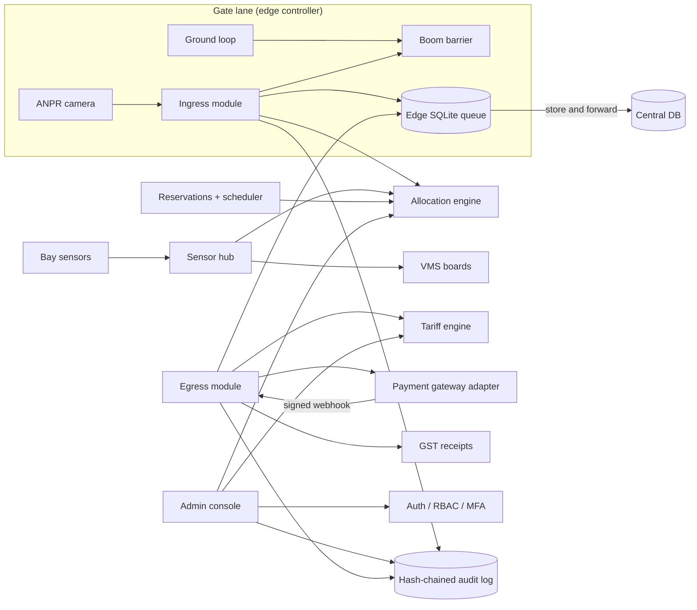

# Vehicle Parking System (VPS)

**SE Mini Project, Group 6, PES University.** This repo implements the
[SRS](docs/part1/SRS_Vehicle_Parking_System.pdf), [SAD](docs/part1/SAD_Vehicle_Parking_System.pdf) and
[Test Plan](docs/part1/Software_Test_Plan_VPS_v1.0.pdf) submitted in Part 1.

A smart car park covering automatic number-plate entry, nearest-bay allocation, live bay LEDs and
signage, dynamic fares with GST, cashless payment, 48-hour pre-booking, an admin console with MFA, and
exportable reports. Gate lanes keep working through a 72-hour network outage. The gate hardware (ANPR
cameras, boom barriers, ground loops, bay sensors, ticket printers) is simulated, so everything runs on
a laptop.

| Team member | SRN | Role | Main areas |
|---|---|---|---|
| Angelo Arakal | PES2UG24CS062 | Repo owner, tech lead | Core, security, auth, audit, ingress, CI |
| Shweta Mailaragouda Patil | PES2UG25CS825 | Developer | Hardware simulators, slot allocation, sensors & VMS, edge queue, UI design system, display & attendant screens |
| Akarsh Parashuram | PES2UG24CS040 | Developer | Tariff engine, payments, exit flow, GST receipts, demo videos |
| Himansh Ahuja | PES2UG24CS923 | QA lead, scrum master | Reservations, admin console, reports, test plan, performance tests, test reports |

See [CONTRIBUTIONS.md](CONTRIBUTIONS.md) for the file-by-file split and the commit/PR plan.

## Quick start

```bash
python -m venv .venv && source .venv/bin/activate     # Windows: .venv\Scripts\activate
pip install -r requirements-dev.txt
python -m vps                                          # http://127.0.0.1:8000
```

Open **http://127.0.0.1:8000**. The overview page links to every screen. API docs are at `/docs`.

| Screen | URL | Try this |
|---|---|---|
| Entry kiosk | `/ui/entry.html` | Issue a ticket and watch the slot, QR code and timings. Then use the loop buttons to see the barrier halt. |
| Exit & pay | `/ui/exit.html` | "Use last issued ticket", add coupon `WELCOME10`, pay by UPI, then "Simulate payment success". |
| Live display | `/ui/display.html` | Click any bay to fire its sensor. The LED and VMS boards update. |
| Pre-book | `/ui/booking.html` | Reserve a bay, then enter with the code at the kiosk. |
| Attendant | `/ui/attendant.html` | `attendant` / `Attendant@123`: alerts, manual entry, cash, barrier override. |
| Admin | `/ui/admin.html` | `admin` / `Admin@123` + TOTP from `python scripts/totp.py admin` |

Dev credentials and secrets are for local use only. Set `VPS_ENV=production` and `VPS_MASTER_SECRET`
(plus the `VPS_*_PASSWORD` variables) for any shared deployment.

### HTTPS (TLS 1.3 only, VPS-SR-001)

```bash
python -m vps --tls        # https://127.0.0.1:8443 with a self-signed dev certificate
```

## Architecture



Edge-to-cloud pattern from SAD 3.4. Each module in `vps/` matches a component in the SAD. HTTP routers
in `vps/api/` are discovered automatically, so each feature ships as a self-contained module.

| Requirement | Where |
|---|---|
| F-001–F-004 entry, ticket, barrier, loop safety | `vps/ingress.py`, `vps/hardware.py` |
| F-005–F-007 allocation, sensors, VMS | `vps/allocation.py`, `vps/sensors.py` |
| F-008–F-010 fares, grace, surge, coupons | `vps/tariff.py` |
| F-011–F-014 exit, payment, barrier, receipts | `vps/egress.py`, `vps/payment.py`, `vps/receipt.py` |
| F-015–F-016 reservations, no-show release | `vps/reservation.py`, `vps/scheduler.py` |
| F-017–F-018 admin, reports | `vps/api/admin.py`, `vps/reports.py` |
| NF-005 72 h offline queue | `vps/edge_queue.py` |
| SR-001 TLS 1.3 · SR-002 Argon2id/AES-256 · SR-003 RBAC+MFA · SR-004 HMAC QR · SR-005 audit | `vps/tls.py`, `vps/security.py`, `vps/auth.py`, `vps/audit.py` |

## Tests and reports

```bash
pytest tests/unit tests/system --cov=vps --cov-branch   # 240+ tests, ~30 s
pytest tests/perf -v                                     # NF-001 / NF-003 load tests (separate server process)
python scripts/generate_reports.py                       # regenerates everything in docs/reports and docs/testing
```

| Deliverable | File |
|---|---|
| Unit Test Report | [docs/reports/Unit_Test_Report.md](docs/reports/Unit_Test_Report.md) (+ PDF, HTML) |
| System Validation Report | [docs/reports/System_Validation_Report.md](docs/reports/System_Validation_Report.md) |
| Code Coverage Report | [docs/reports/Code_Coverage_Report.md](docs/reports/Code_Coverage_Report.md) (+ line-level HTML) |
| Branch Coverage Report | [docs/reports/Branch_Coverage_Report.md](docs/reports/Branch_Coverage_Report.md) |
| Test Plan v1.1 | [docs/testing/Software_Test_Plan_v1.1.md](docs/testing/Software_Test_Plan_v1.1.md) |
| Test Case Specification v1.1 | [docs/testing/Test_Case_Specification.md](docs/testing/Test_Case_Specification.md) |
| Deviations from Part 1 documents | [docs/Deviations.md](docs/Deviations.md) |
| Sprint plan and backlog | [docs/sprints/Sprint_Plan.md](docs/sprints/Sprint_Plan.md), [backlog/backlog.csv](backlog/backlog.csv) |
| Sprint demo videos | [demo/](demo/) |

CI (`.github/workflows/ci.yml`) runs lint, then unit and system tests on Python 3.11 and 3.12 with a 90%
branch-coverage gate, then the performance suite. Test and coverage reports are uploaded as build
artefacts. `.github/workflows/pr-automation.yml` labels PRs, assigns the author, checks the PR links a
backlog story and adds it to the Project board.

## Repository layout

```
vps/            application package (one module per SAD component)
vps/api/        HTTP routers (auto-discovered)
web/            kiosk, exit, display, booking, attendant and admin screens (no build step)
tests/unit      module tests          tests/system  end-to-end, security, resilience
tests/perf      load & scalability    scripts/      backlog setup, TOTP helper, report generator
docs/           Part 1 PDFs, test plan v1.1, test cases, reports, deviations, sprint plan
backlog/        backlog.csv (stories, points, owners, sprints)
demo/           sprint demo videos + recording script
```
